# HustleHub+

A secure freelance marketplace platform that allows freelancers to advertise
services and clients to browse and book those services. The system will
record the financial transactions generated through bookings and give
freelancers an indication of income earned and estimated tax obligations.

This document covers **Part 1 — Secure Foundations**: the backend API,
authentication, and the security decisions behind it. Marketplace features
(gigs, bookings, transactions, tax estimation), the React frontend, and
DevSecOps work are out of scope for this part and will be documented as they
are built in Parts 2 and 3.

---

## Table of Contents

- [Overview](#overview)
- [Intended Users](#intended-users)
- [System Architecture](#system-architecture)
- [Backend Structure](#backend-structure)
- [Registration and Login](#registration-and-login)
- [Security Decisions](#security-decisions)
- [Getting Started](#getting-started)
- [API Endpoints](#api-endpoints)
- [Testing](#testing)
- [Demonstration](#demonstration)
- [Team](#team)

---

## Overview

HustleHub+ is a freelance marketplace: freelancers advertise services
("gigs"), and clients browse and book them. Because the platform will go on
to handle account credentials, booking records, and income and tax data, Part
1 treats security as a foundation rather than something bolted on afterward —
the backend built here is a small, self-contained authentication API that
Parts 2 and 3 extend rather than rework.

## Intended Users

The platform is designed around three roles. Part 1 implements the first two;
`admin` is a reserved role that exists in the data model but can't yet be
reached, since the marketplace features it would administer haven't been
built.

| Role | Description | Status in Part 1 |
|---|---|---|
| **Client** | Books gigs from freelancers. Default role on registration. | Can register and log in |
| **Freelancer** | Advertises gigs and tracks income from bookings. | Can register and log in |
| **Admin** | Platform oversight (Part 2+). | Reserved role; not self-assignable, no admin account can currently be created |

## System Architecture

The diagram below shows the MERN architecture as it stands at the end of
Part 1: a client sends a request over HTTPS into the Express backend, which
routes it through a request pipeline before anything touches storage. The
"M" and the "F" of MERN are placeholders for now — user data lives in a
locked JSON file rather than MongoDB, and there is no client yet — both are
scheduled Part 2 work, not gaps in what Part 1 was meant to deliver.


**System boundary.** Everything inside the outer box is the API process; the
client and the eventual MongoDB deployment sit outside it. The only way in is
through the request pipeline — there's no code path that reaches the domain
logic or the store without first passing validation and, on protected
routes, JWT verification.

## Backend Structure

The backend is a Node.js and Express API with no database yet: users live in
a JSON file behind a small datastore module, which keeps Part 1
self-contained while leaving an obvious seam to swap in MongoDB later. Every
request follows the same path in, and every response leaves through the same
pair of senders, so the API answers in one shape no matter which endpoint was
hit.

| Folder | Holds | Rule it follows |
|---|---|---|
| `config/` | `env.js` | The only file in the API that reads `process.env` |
| `routes/` | `index.js`, `authRoutes.js` | Declares paths, never logic |
| `controllers/` | `authController.js` | Handles a request, delegates the work |
| `models/` | `userModel.js` | Owns the shape of a user and how one is found or made |
| `store/` | `jsonStore.js` | Reads and writes the JSON files, with a lock |
| `services/` | `passwordService.js`, `tokenService.js` | Hashing and tokens |
| `middleware/` | `validationMiddleware.js`, `requireAuth.js`, `roleMiddleware.js`, `rateLimitMiddleware.js`, `notFound.js`, `errorHandler.js` | Runs before or after a handler |
| `utils/` | `apiResponse.js`, `httpStatus.js` | The response envelope and status codes |

`app.js` builds the Express application and exports it without starting a
listener. `server.js` starts it, choosing HTTPS or HTTP depending on whether
a certificate is present (see [HTTPS](#https)). Splitting the two means the
same app object can be wrapped in an HTTPS server, or imported directly by a
test runner in Part 2, without touching `app.js`.

**Request lifecycle:**

```
request
  -> express.json({ limit: '10kb' })     body parsed, oversized bodies refused
  -> app.use('/api', routes)             the router index
       -> /health                        liveness probe
       -> /auth  -> authRoutes           register, login, profile, admin
            -> loginRateLimiter          login only, failed attempts capped
            -> validation                format and strength rules, 400 on failure
            -> requireAuth               protected routes only
            -> authorizeRoles            role restricted routes only
            -> controller                delegates and responds
  -> notFound                            nothing matched, 404
  -> errorHandler                        anything that threw, controlled reply
```

The order matters: `notFound` is mounted second-last and `errorHandler` last,
so a route registered below either of them would simply never run.

**Response envelope.** Every response takes one of two shapes. Success
bodies carry `data` and never `errors`; failure bodies carry `errors` and
never `data`.

```json
{ "success": true,  "message": "user registered successfully", "data": { } }
{ "success": false, "message": "email already registered",     "errors": [ ] }
```

Field-level validation detail goes in `errors`:

```json
{
  "success": false,
  "message": "validation failed",
  "errors": [
    { "field": "email", "message": "must be a valid email address" },
    { "field": "password", "message": "must be between 8 and 128 characters" }
  ]
}
```

## Registration and Login

### Registration flow

1. The client sends `POST /api/auth/register` with `fullName`, `email`,
   `password`, and an optional `role`, over HTTPS.
2. `express.json` parses the body, rejecting anything over 10kb before it's
   even buffered.
3. `validateRegister` checks every field before reporting anything, so one
   reply lists everything wrong with the request instead of one fault at a
   time: full name (2–100 characters, letters/spaces/hyphens/apostrophes
   only), email (valid format, ≤254 characters), password (8–128
   characters, at least one letter and one digit), and role (if present,
   must be a string).
4. The controller resolves the requested role — `client` or `freelancer`
   only. `admin` is a real stored role, but it's deliberately left off the
   self-assignable list, so no request body can produce one.
5. The controller checks the email against existing users first, so an
   obvious duplicate doesn't pay for a bcrypt run, and returns
   `409 Conflict` if it's already registered.
6. The password is hashed with bcrypt (work factor from config, minimum
   10). It travels no further than the controller — only the hash reaches
   the model.
7. The user model builds the record and writes it through the JSON store,
   whose duplicate check re-runs **inside the same file lock** as the
   insert, closing the race window left open between steps 5 and 7.
8. The response returns `201 Created` with the safe user object — never the
   password hash.

### Login flow

1. The client sends `POST /api/auth/login` with `email` and `password`.
2. A per-client rate limiter allows 5 failed attempts per minute before
   replying `429 Too Many Requests`. Successful logins don't count against
   that limit, so a legitimate user can never be locked out of their own
   account.
3. `validateLogin` checks only that both fields are present — deliberately
   looser than registration (see [Input Validation](#input-validation)).
4. The controller looks up the user by email and compares the supplied
   password against the stored hash with bcrypt. An unknown email and a
   wrong password return the **same** `401 Unauthorized` with the same
   message, so the reply itself can't be used to work out which addresses
   are registered.
5. On a match, `tokenService.generateToken({ id, role })` issues a JWT
   signed with the server's secret, expiring after the configured lifetime
   (default 1 hour).
6. The response returns `200 OK` with the safe user object and the token.
7. The client sends that token on every later request as
   `Authorization: Bearer <token>`.
8. `requireAuth` extracts and verifies the token on every protected route.
   A missing, malformed, expired, or forged token all produce the same
   `401 Unauthorized` — the middleware never gives away which case it was.
   On success, the verified `id` and `role` are attached to `req.auth` for
   whatever handler runs next.
9. `authorizeRoles(...)` (used on `/api/auth/admin`) runs after
   `requireAuth` and checks `req.auth.role` against an allow-list, replying
   `403 Forbidden` for a caller who is authenticated but not permitted.

## Security Decisions

Each decision below is a trade-off, not a feature checklist — what follows
is the reasoning behind what the code actually does, checked by reading it
and by running the API locally.

### Password Hashing

Passwords are hashed with **bcrypt** (`bcryptjs`, the pure-JavaScript build,
chosen so the project installs without native build tools on any machine) at
a work factor of 12; the config loader raises anything below 10 rather than
trusting it. Hashing is used instead of encryption because it's one-way —
there's no key that turns a hash back into the original password, so a
stolen hash can be guessed against but never reversed. Plain-text passwords
are never retained: the user model's `buildUser()` takes a `passwordHash`
and has no parameter for a plain password at all, so storing one by accident
would mean changing the model itself, not just a careless call site. The
`toPublicUser()` serialiser works as an **allowlist** rather than a strip —
it copies out the fields named as public instead of deleting the sensitive
ones — so any field added to a user record later is private by default and
has to be deliberately named before it shows up in a response. Even the
password length ceiling (128 characters) is a security control rather than a
formatting rule: hashing is deliberately slow, so an unbounded password
would be a cheap way to burn the server's processor time.

### Token-Based Authentication (JWT)

A JWT is issued on successful login via `jsonwebtoken`, signed with a secret
read from `JWT_SECRET` and expiring after `JWT_EXPIRES_IN` (default `1h`).
The payload is kept deliberately thin — `{ id, role }` — because a JWT
payload is base64-encoded, not encrypted, so anyone holding the token can
read it; no email or name goes anywhere near it. On every protected request,
`requireAuth` pulls the bearer token from the `Authorization` header and
verifies it against that same secret, and it's the verified `id` and `role`
— not anything the caller typed — that the rest of the request trusts. If
`JWT_SECRET` is left unset the API still boots: it generates a throwaway
secret for that process only and logs a warning, which keeps a fresh clone
runnable but means any token issued that way stops verifying the moment the
process restarts — a deliberate nudge to go set a real one.

### Input Validation

Validation is **whitelist-based**: patterns describe what a value is allowed
to contain rather than trying to list everything it isn't, so a character
nobody thought to block is refused by default. Every pattern is anchored at
both ends (`^...$`), because leaving it unanchored means it can match a
fragment and let junk through wrapped around something that merely looks
valid. Registration checks full name, email format and length, and password
length and strength; login checks only that both fields are present. That
gap is intentional — a format rule on login would answer a malformed email
with `400` while every other failed login answers `401`, and that
difference alone would tell an attacker which addresses are worth guessing
at. So login is checked as loosely as correctness allows, while everything
else gets rejected before it ever reaches business logic.

### HTTPS

`server.js` looks for a PFX certificate bundle at the path configured by
`SSL_PFX_PATH` (default `api/certs/localhost.pfx`). When it's there, the app
is served with `https.createServer({ pfx, passphrase }, app)`; when it's
not, the server falls back to plain HTTP and says so loudly
(`no certificate found, starting over http instead of https`) rather than
failing silently. Certificate and key material is excluded via `.gitignore`
(`*.pem`, `*.key`, `*.crt`, `*.pfx`, `*.p12`), so a fresh clone never
inherits someone else's private key — whoever runs it locally generates
their own self-signed certificate and points `SSL_PFX_PATH` at it. HTTPS
matters here specifically because both the login request (carrying a
password) and every request after it (carrying a bearer token) would
otherwise cross the network in plain text, readable or replayable by anyone
sitting on the same path.

### Error Handling

A single error-handling middleware, mounted last in `app.js`, catches every
thrown error and rejected promise from anywhere in the request — including
a body that failed to parse before any route even ran. It has one contract:
**nothing derived from the error object reaches the response.** The message
sent back is chosen from a fixed table keyed by `error.type`
(`entity.parse.failed`, `entity.too.large`, and a generic fallback) — never
`error.message`, never `error.stack`, never a path leaked by the parser. The
full error is still logged server-side with `console.error`, so nothing is
lost for debugging. This exists because, before the handler was written, a
malformed JSON body used to return a raw stack trace containing the
project's absolute file path — exactly the kind of internal detail the POE
brief requires the API to never expose.

## Getting Started

**Prerequisites:** Node.js ≥ 18.

```bash
cd api
npm install
cp .env.example .env      # then fill in JWT_SECRET
npm run dev                # nodemon, or npm start for a plain run
```

The API boots without a configured secret or certificate — it generates a
throwaway JWT secret and falls back to HTTP, both loudly logged — so a fresh
clone is runnable immediately. For a proper local run:

1. Generate a signing secret:
   `node -e "console.log(require('crypto').randomBytes(32).toString('hex'))"`
   and set it as `JWT_SECRET` in `.env`.
2. Generate a local self-signed certificate and bundle it as a `.pfx`, then
   set `SSL_PFX_PATH` (and `SSL_PFX_PASSWORD` if the bundle is password
   protected) in `.env`. From inside `api/`:

   ```bash
   mkdir -p certs
   openssl req -x509 -newkey rsa:2048 -nodes -sha256 -days 365 \
     -keyout certs/localhost-key.pem -out certs/localhost-cert.pem -subj "/CN=localhost"
   openssl pkcs12 -export -out certs/localhost.pfx \
     -inkey certs/localhost-key.pem -in certs/localhost-cert.pem -passout pass:
   ```

   On Windows, if `openssl` isn't recognised in PowerShell, use Git Bash, or
   call Git's bundled copy directly
   (`"C:\Program Files\Git\usr\bin\openssl.exe"`).
3. `npm run dev` and confirm the console reports
   `hustlehub+ api listening at https://localhost:5000`.

| Variable | Purpose | Default |
|---|---|---|
| `NODE_ENV` | `development` or `production` | `development` |
| `PORT` | Port the API listens on | `5000` |
| `JWT_SECRET` | Token signing secret | generated per-process if unset |
| `JWT_EXPIRES_IN` | Token lifetime | `1h` |
| `BCRYPT_ROUNDS` | bcrypt work factor | `12` (raised to 10 minimum) |
| `SSL_PFX_PATH` | Path to the local certificate bundle | `api/certs/localhost.pfx` |
| `SSL_PFX_PASSWORD` | Passphrase for the bundle | (blank) |

## API Endpoints

Verified by running the API locally against every scenario listed below.

| Method | Endpoint | Purpose | Authentication | Expected Response |
|---|---|---|---|---|
| GET | `/api/health` | Liveness probe | None | `200` — status, uptime, timestamp |
| POST | `/api/auth/register` | Create an account | None | `201` + safe user · `400` validation/invalid role · `409` duplicate email |
| POST | `/api/auth/login` | Authenticate and issue a JWT | None (rate-limited) | `200` + safe user + token · `400` missing fields · `401` invalid credentials · `429` too many attempts |
| GET | `/api/auth/profile` | Return the account behind the token | Bearer JWT | `200` + safe user · `401` missing/invalid/expired token · `404` account no longer exists |
| GET | `/api/auth/admin` | Demonstrates a role-restricted route | Bearer JWT + `admin` role | `200` · `401` no/invalid token · `403` wrong role |

## Testing

The API is tested with a Postman collection that exercises all five
endpoints above, alongside the invalid-input cases the brief calls out
specifically: duplicate email, wrong password, missing fields, and malformed
JSON.

- **Collection:** [`docs/postman/HustleHub.postman_collection.json`](docs/postman/HustleHub.postman_collection.json)
- **Running it:** import the file into Postman, then turn off "SSL
  certificate verification" under Settings → General — the API is served
  over a self-signed local certificate, which Postman won't trust by
  default. Run the Register success request first, then Login success,
  before touching Profile or Admin; the collection captures a test email and
  a bearer token automatically through request scripts, so nothing needs to
  be copied by hand.
- **What's covered:**
  - **Health** — liveness check
  - **Register** — success, duplicate email (`409`), missing fields (`400`),
    invalid email format (`400`), weak password (`400`), disallowed role
    (`400`), malformed JSON body (`400`, safe error message only)
  - **Login** — success with token, wrong password (`401`), unknown email
    (`401`, identical message to wrong password), missing fields (`400`),
    malformed JSON (`400`), rate limiting (`429` after repeated failures)
  - **Profile** — valid token (`200`), missing token (`401`), malformed
    token (`401`)
  - **Admin** — non-admin token (`403`), missing token (`401`)
- **Known gap:** the `/api/auth/admin` success path (a genuinely valid admin
  token) can't be demonstrated, because registration only allows
  self-assigning `client` or `freelancer`
  (`api/models/userModel.js`, `SELF_ASSIGNABLE_ROLES`) and nothing in this
  API creates an admin account. Only the `401` and `403` cases are covered.
- **Screenshots:** a response capture for every scenario listed above,
  organised by endpoint, showing status code and JSON body:

  <details>
  <summary>Health</summary>

  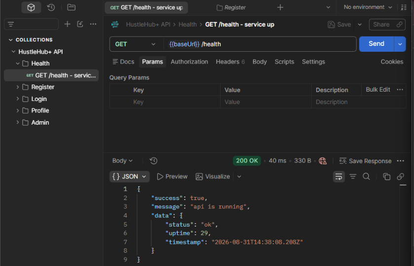
  </details>

  <details>
  <summary>Register</summary>

  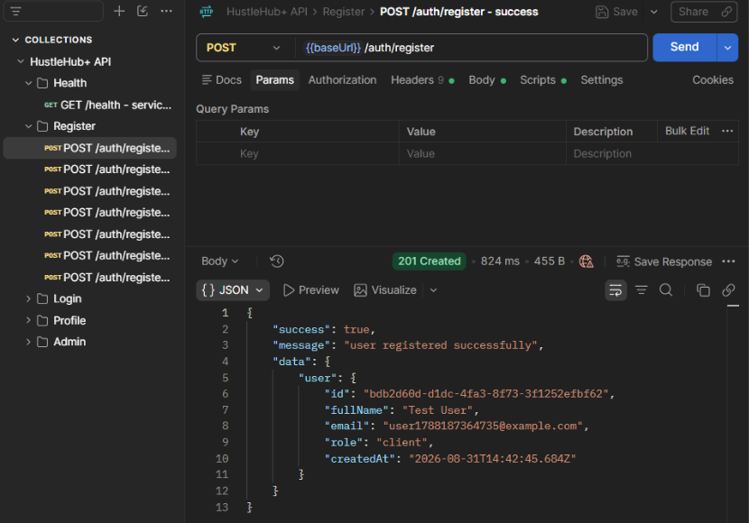
  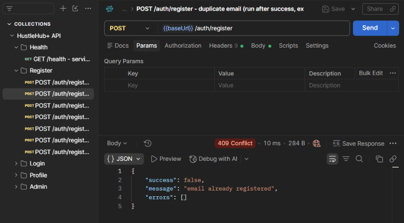
  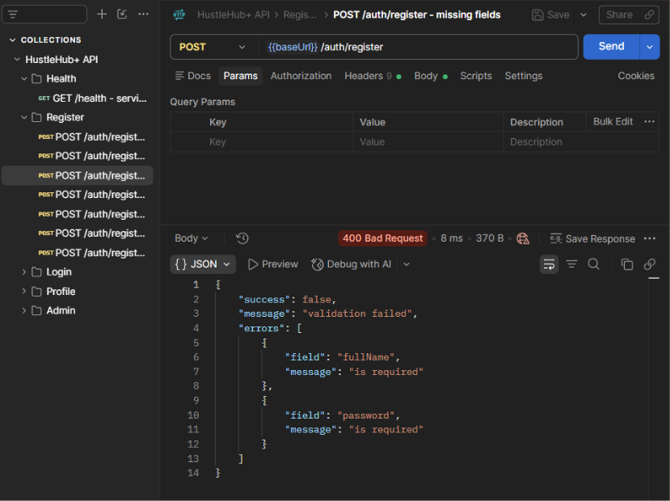
  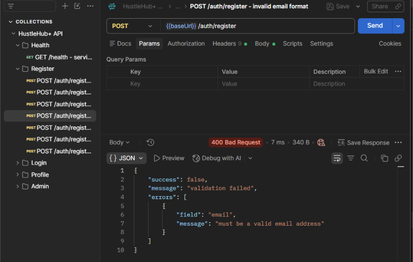
  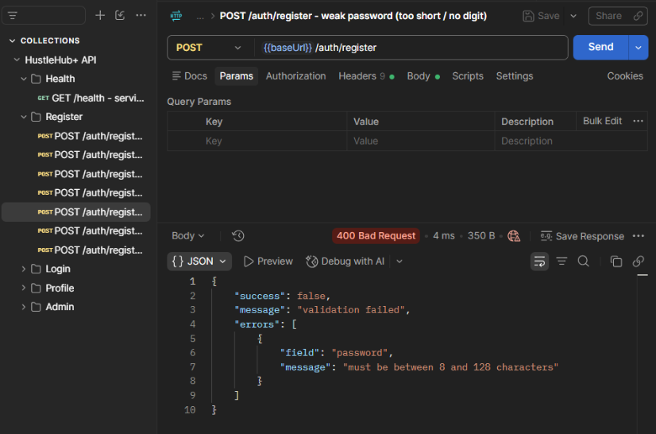
  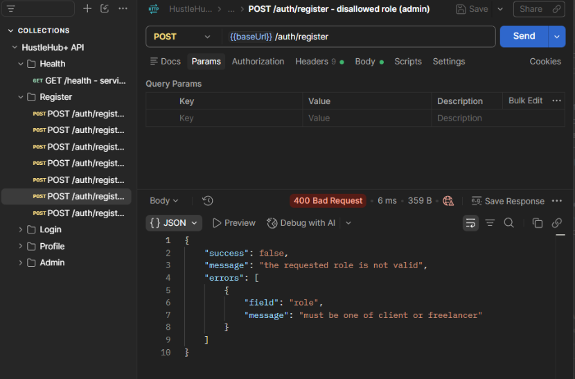
  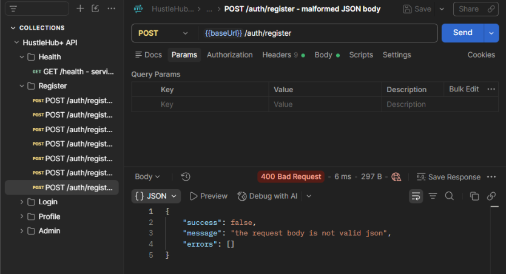
  </details>

  <details>
  <summary>Login</summary>

  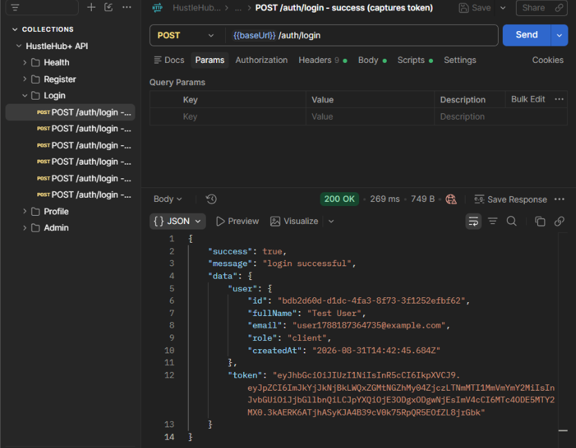
  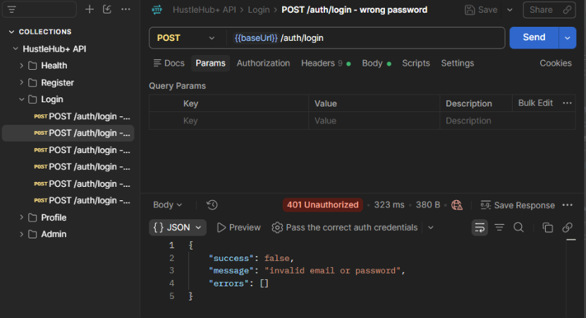
  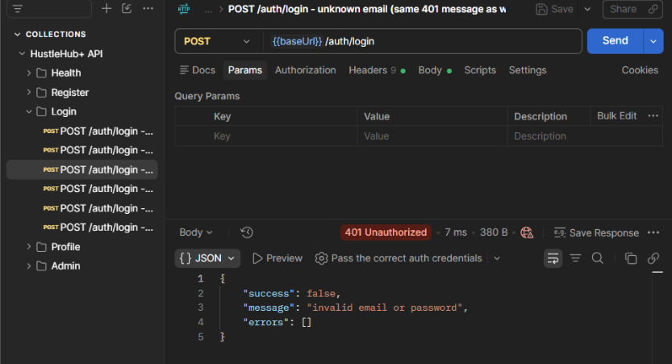
  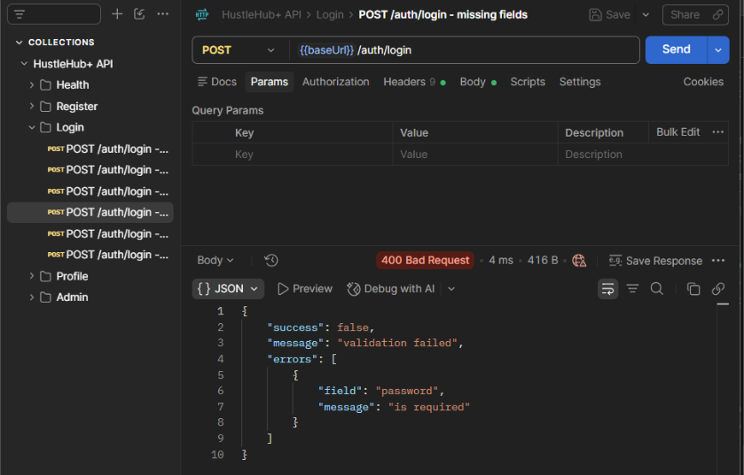
  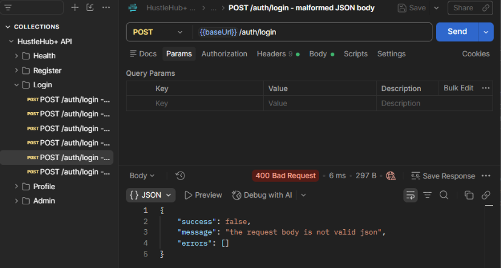
  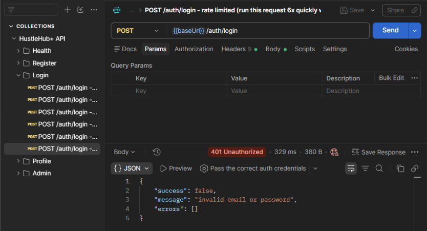
  </details>

  <details>
  <summary>Profile</summary>

  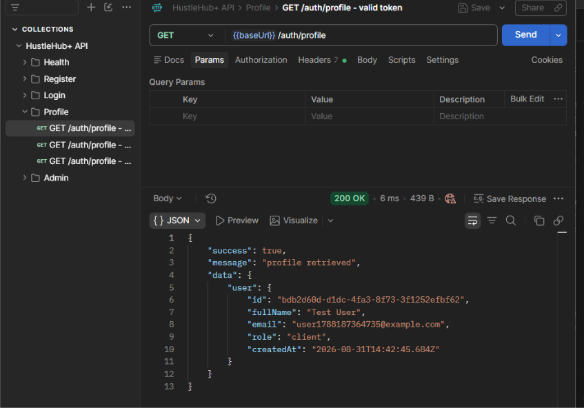
  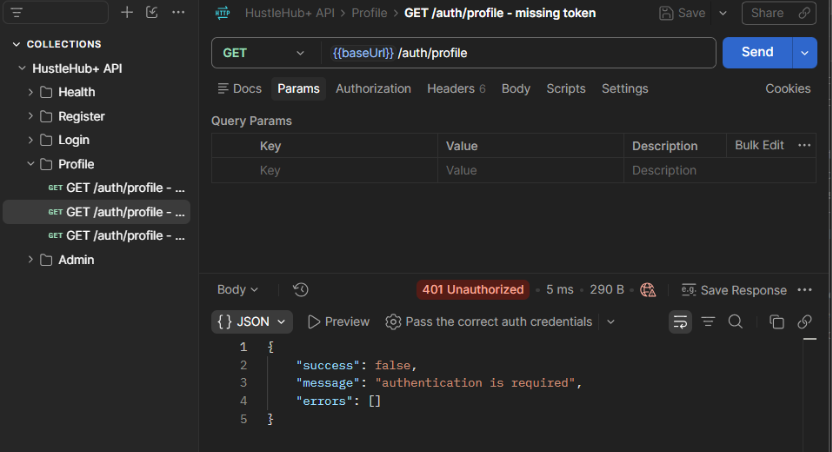
  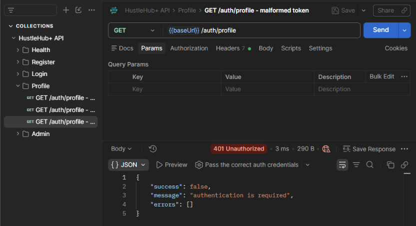
  </details>

  <details>
  <summary>Admin</summary>

  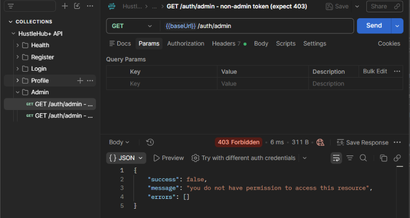
  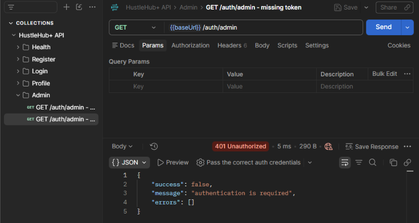
  </details>

## Demonstration

A recorded walkthrough shows the API starting over HTTPS, a registration, a
login that returns a token, and an authenticated profile call using that
token.

- **Video:** TODO — link once recorded and uploaded.

## Team

| Role | Responsibility | Member |
|---|---|---|
| Role 1 | Backend / API Lead | Christiaan - ST10434131 |
| Role 2 | Security Specialist | Morgan - ST10257779 | 
| Role 3 | Architecture & Docs | Neville - ST10404539 |
| Role 4 | Testing & Submission | Ethan - ST10444972 |
